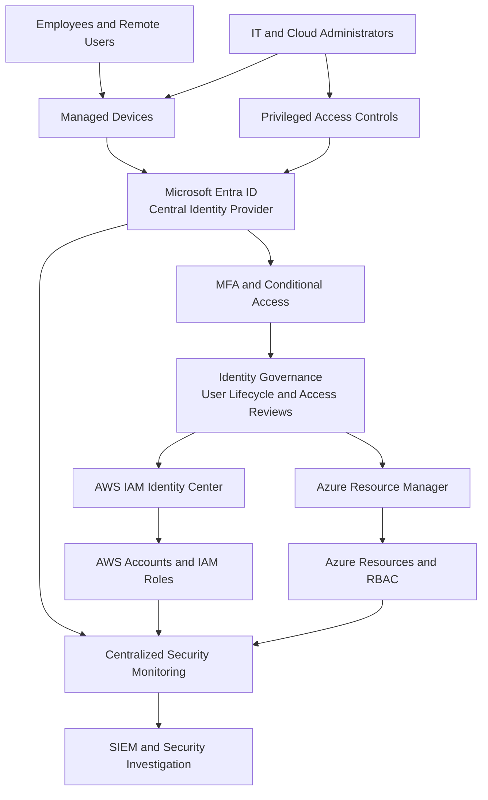

# NorthStar Technologies – Enterprise IAM Architecture

## 1. Architecture Overview

The proposed architecture establishes Microsoft Entra ID as the central identity provider for NorthStar Technologies.

The architecture supports centralized authentication, federated access to AWS, Azure resource authorization, privileged access controls and centralized security monitoring.

The design follows Zero Trust principles and applies identity verification, least privilege and continuous monitoring.

## 2. Proposed Architecture Diagram

## 3. Architecture Components

### 3.1 Central Identity Provider – Microsoft Entra ID

Microsoft Entra ID is proposed as the central identity provider.

Responsibilities:
- Authenticate organizational users.
- Support Single Sign-On (SSO).
- Enforce Multi-Factor Authentication (MFA).
- Apply Conditional Access policies.
- Support identity lifecycle management.
- Provide identity and sign-in audit logs.

### 3.2 AWS Identity Integration

AWS IAM Identity Center will provide federated access to designated AWS accounts.

Proposed controls:
- Federate user authentication through Microsoft Entra ID.
- Assign AWS permission sets based on job responsibilities.
- Apply least-privilege permissions.
- Separate administrative and standard access.
- Review account assignments regularly.

### 3.3 Azure Resource Access

Azure resources will use Microsoft Entra ID identities and Azure Role-Based Access Control.

Proposed controls:
- Assign permissions through Azure RBAC.
- Use built-in roles where appropriate.
- Avoid unnecessary subscription-wide privileges.
- Apply least-privilege permissions.
- Review privileged role assignments.

### 3.4 Privileged Access

Administrative access will be protected through additional controls.

Proposed controls:
- Separate standard and privileged accounts.
- Enforce strong MFA.
- Use just-in-time access where supported.
- Restrict permanent administrative privileges.
- Record and monitor privileged activities.

### 3.5 Security Monitoring

Relevant identity and cloud activity logs will be collected for security investigation.

Proposed sources:
- Microsoft Entra sign-in logs.
- Microsoft Entra audit logs.
- AWS CloudTrail.
- Azure Activity Logs.

A SIEM platform such as Microsoft Sentinel may be used for centralized monitoring and investigation.

## 4. Authentication Flow

1. An employee attempts to access an organizational application.
2. The request is directed to Microsoft Entra ID.
3. The identity provider verifies the user's identity.
4. MFA and applicable Conditional Access policies are evaluated.
5. The user receives access only when the required conditions are satisfied.
6. AWS or Azure authorization controls determine which resources the user can access.
7. Relevant activity is recorded in security logs.

## 5. Authorization Model

Authentication confirms identity. Authorization determines what that identity is allowed to access.

The architecture separates these responsibilities.

| Platform | Authentication | Authorization |
|---|---|---|
| Microsoft Entra ID | Identity verification and MFA | Application and directory roles |
| AWS | Federated authentication | IAM Identity Center permission sets and IAM policies |
| Azure | Microsoft Entra ID | Azure RBAC |

## 6. Architecture Design Principles

- Centralized identity management.
- Strong authentication.
- Least privilege.
- Separation of duties.
- Federated cloud access.
- Privileged access protection.
- Continuous security monitoring.
- Defense in depth.

## 7. Design Assumptions and Limitations

- Microsoft Entra ID is the proposed central identity provider.
- AWS IAM Identity Center is used for federated AWS access.
- Azure RBAC controls access to Azure resources.
- Licensing and feature availability must be validated before implementation.
- Device compliance requires an appropriate device management solution.
- Privileged access features depend on the selected platform capabilities and licensing.
- No live cloud federation or production configuration has been performed.

## 8. Document Status

Status: Proposed conceptual architecture  
Project: Enterprise IAM and Zero Trust Architecture  
Organization: NorthStar Technologies (fictional)