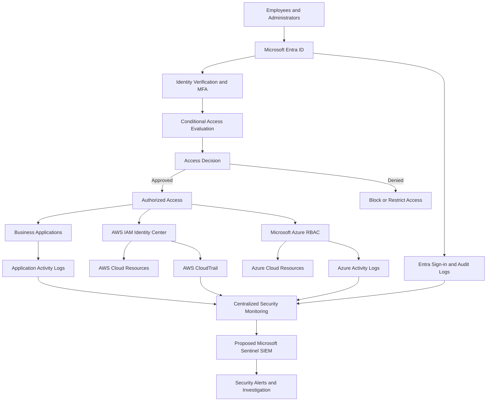

# Enterprise IAM Architecture Diagram

## Project Context

This diagram represents the proposed identity and access architecture for NorthStar Technologies, a fictional organization.

## Architecture

## Architecture Components

| Component | Purpose |
|---|---|
| Microsoft Entra ID | Central workforce identity management |
| MFA | Additional authentication verification |
| Conditional Access | Context-based access decisions |
| AWS IAM Identity Center | Federated workforce access to AWS |
| Azure RBAC | Controls permissions to Azure resources |
| AWS CloudTrail | Records AWS account activity |
| Azure Activity Logs | Records Azure resource and subscription activity |
| Microsoft Sentinel | Proposed centralized security monitoring |

## Important Note

This is a conceptual architecture diagram for a fictional organization. It has not been deployed or validated in a live cloud environment.